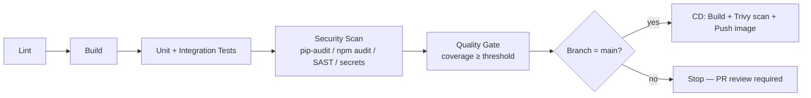

# AI & Developer Security + Deployment Playbook

**Purpose:** A portable, project-agnostic guide that any developer (or an AI
coding agent) can drop into a repository to run a repeatable security audit
and wire up a CI/CD pipeline **before** code ships to `dev`.

This folder is **not** part of any single project's repo. Copy the pieces you
need into your project (or point the audit script at your repo path) — do not
commit this folder itself unless you intentionally want to vendor it.

```text
ai-dev-security-playbook/
├── README.md                 ← this file
├── docs/
│   ├── INTEGRATION_GUIDE.md    ← how to add and maintain the playbook in another repo
│   ├── RELEASE_GUIDE.md         ← Conventional Commits, versioning, changelog, release automation
│   └── TECH_STACK.md             ← recommended base stack + how to adapt to other tech
├── SECURITY.md                    ← vulnerability disclosure policy for this repo
├── CONTRIBUTING.md                  ← how to change this repo without breaking consumers
├── security/                          ← THIS repo's own audit trail (see security/README.md)
│   ├── README.md
│   ├── PIPELINE_AND_RELEASE_REVIEW.md
│   └── reports/                        ← dated CYB/audit reports from self-auditing this repo
├── .github/                             ← this repo's OWN active CI/CD (see § below), not a template
│   ├── workflows/ci.yml                  ← lint + validate + self-audit, on every push/PR
│   ├── workflows/release.yml              ← release-please for the playbook's own version
│   └── dependabot.yml                      ← keeps this repo's own Actions current
├── release-please-config.json              ← this repo's own release-please config
├── .release-please-manifest.json            ← this repo's own current version
├── audit/
│   ├── README.md              ← how to run the audit / scaffold scripts
│   ├── run-audit.ps1           ← Windows/PowerShell audit → verdict + 2 reports
│   ├── run-audit.sh             ← Linux/macOS/Git-Bash equivalent
│   ├── scaffold-bia-acp.ps1      ← scaffolds a dated BIA/ACP addendum (Windows)
│   ├── scaffold-bia-acp.sh        ← same, for Linux/macOS/Git-Bash
│   └── reports/                    ← generated at runtime, not checked in
├── templates/
│   ├── README.md              ← when to use each template
│   ├── CYB_REPORT_TEMPLATE.md   ← manual/deeper security report template
│   └── BIA_ACP_TEMPLATE.md       ← governance template (human-rated)
└── pipelines/
    ├── README.md              ← stage-by-stage equivalence table
    ├── github/
    │   ├── README.md           ← GitHub-specific setup checklist
    │   ├── ci.yml               ← lint → build → test → security → quality gate
    │   ├── cd.yml                ← build/push image, Trivy-gated
    │   ├── dependabot.yml         ← weekly dependency bumps (docker/pip/npm)
    │   ├── release.yml             ← release-please workflow (see docs/RELEASE_GUIDE.md)
    │   ├── release-please-config.example.json
    │   └── release-please-manifest.example.json
    └── gitlab/
        ├── README.md           ← GitLab-specific setup checklist
        ├── .gitlab-ci.yml        ← same stages, GitLab CI syntax + built-in scanners
        ├── renovate.json          ← dependency bumps (GitLab has no Dependabot)
        ├── release-job.example.yml ← semantic-release job to merge in (see docs/RELEASE_GUIDE.md)
        └── .releaserc.example.json
```

> **Don't confuse the two pipelines.** `.github/workflows/` at the repo root
> is this playbook's **own** CI (lints/validates the scripts and YAML you're
> about to copy, and self-audits this repo — see `security/README.md`).
> `pipelines/github/` and `pipelines/gitlab/` are **templates for the repo
> you're integrating this into** — see §1 below and `docs/INTEGRATION_GUIDE.md`.

---

## 1. How to use this playbook

For copy commands, recommended destination paths, updates, and attribution
behavior, start with [`docs/INTEGRATION_GUIDE.md`](docs/INTEGRATION_GUIDE.md).

1. **Pick your tech stack.** See `docs/TECH_STACK.md` for the recommended default
   (Python FastAPI/Django + React) and how to retarget the audit/pipelines
   onto a different stack if needed.
2. **Pick your CI/CD platform.** Copy `pipelines/github/*` into `.github/`
   (and `.github/workflows/`) **or** copy `pipelines/gitlab/*` into your repo
   root — whichever platform your project is hosted on. Don't add both.
3. **Set up release automation.** See `docs/RELEASE_GUIDE.md` — Conventional
   Commits in, automated SemVer tag + changelog out, via `release.yml`
   (GitHub) or `release-job.example.yml` (GitLab).
4. **Run the audit** locally (or wire it into CI as a gate) before anything
   goes to `dev`:

   ```powershell
   # Windows
   pwsh -File audit\run-audit.ps1 -RepoPath C:\path\to\your\repo
   ```

   ```bash
   # Linux / macOS / Git-Bash
   bash audit/run-audit.sh /path/to/your/repo
   ```

5. **Read the verdict** printed at the end (and saved under
   `audit/reports/` in your repo). Act on it before deploying — see §3.
6. **For a formal point-in-time report or a BIA/ACP addendum**, see
   `templates/README.md` — the audit already auto-generates a CYB-style
   report (`audit/reports/CYB_report_<timestamp>.md`); the BIA/ACP addendum
   is scaffolded via `audit/scaffold-bia-acp.ps1` / `.sh` and then completed
   by hand (it needs a human business judgment call, not just a scan).

This mirrors the process already used in production for the SE_DI_PIP
project (`security/README.md` + `security/run-audit.ps1`), generalized so it
works on **any** repo shape (Python backend, Node frontend, monorepo, or
either alone).

---

## 2. The checklist (what the audit automates)

Legend: **[A]** = automated by `run-audit` · **[M]** = manual, deployment-dependent.

### A. Authentication & access control

- **[M]** Every API route requires a valid identity (JWT / OAuth2 / API key / proxy auth). No credential travels in a **query string** (CWE-598).
- **[A]** Source code declares an auth/security dependency on API routes (`Depends(...)`, `Security(...)`, `HTTPBearer`, `OAuth2`, middleware, guards, decorators).
- **[M]** Authorization is enforced — a caller can only reach data it's entitled to.
- **[M]** Data-access events are logged with the authenticated principal.

### B. Transport & network

- **[M]** App is served over **HTTPS**; HTTP redirects to HTTPS.
- **[A]** No hardcoded `http://` base URLs in the frontend API client (informational warning only — some are legitimate, e.g. local dev).
- **[M]** Service is not bound to `0.0.0.0` in production without a firewall/proxy in front.
- **[A]** CORS is **not** a catch-all wildcard (`allow_origin_regex=".*"`, `Access-Control-Allow-Origin: *` with credentials, etc.).

### C. Application hardening

- **[M]** Security headers present: `Content-Security-Policy`, `X-Content-Type-Options: nosniff`, `X-Frame-Options`/`frame-ancestors`, `Referrer-Policy`, `Strict-Transport-Security`.
- **[M]** Rate limiting / request timeouts protect expensive endpoints.
- **[A]** SQL stays parameterized — no f-string/format-string interpolation of variables into query text.
- **[A]** No obvious XSS sinks (`dangerouslySetInnerHTML`, `.innerHTML =`, `eval(`) in frontend source.

### D. Secrets & identity

- **[A]** No `.env`, key, certificate, or token-cache files tracked by git.
- **[A]** No secret-like filename ever committed to git *history*, even if removed from tracking since — a working-tree-only check (the item above) cannot see this by construction. See §5 for why this matters.
- **[A]** A pre-commit secret-scan hook (`.githooks/pre-commit`) is present in the repo, so a secret is caught before it's ever committed, not after.
- **[M]** Any token cache / credential file on disk is OS-permission-protected (e.g. `0600`).
- **[M]** OAuth/OIDC app registration is dedicated to this app, not a shared/public client ID.
- **[M]** DB/service connection info is environment-driven, not hardcoded.

### E. Dependencies & supply chain

- **[A]** `npm audit` reports no High/Critical vulnerabilities (for every `package.json` found).
- **[A]** `pip-audit` reports no known vulnerabilities (for every `requirements*.txt` found).
- **[A]** Dependencies are pinned (`==`, lockfile with hashes), not open `>=`/`~=` ranges.
- **[M]** Deployments reference container images by immutable digest (`@sha256:...`), not `latest`.

### F. CI/CD & containers

- **[M]** CI runs dependency audits, SAST (CodeQL/Bandit/Semgrep), and secret scanning (gitleaks/trufflehog) on every change.
- **[M]** CD scans built images (Trivy/Grype) and blocks push on High/Critical.
- **[A]** Every `Dockerfile` found sets a non-root `USER`.
- **[M]** Containers run read-only-fs / dropped-caps where feasible; have a `HEALTHCHECK`.
- **[M]** Pushes straight to the default branch are blocked; merges go through gated CI/PR review.

### G. Governance

- **[M]** Logging uses a structured logger (levels), not bare `print`/`console.log`; no upstream response bodies echoed verbatim.
- **[M]** A `SECURITY.md` with a disclosure contact exists at the repo root.

---

## 3. Reading the verdict

`run-audit` classifies every automated finding by severity and rolls them up
into one of three deploy-readiness verdicts, printed at the end and written
to `audit/reports/audit-report-<timestamp>.md`:

| Verdict | Meaning | Action |
| --- | --- | --- |
| 🟢 **LOW RISK** | All automated controls pass. No criticals, no warnings. | Safe to deploy to `dev`. |
| 🟡 **ACCEPTED RISK** | No criticals/highs failed, but warnings exist (e.g. unpinned deps, missing Dockerfile `USER`, informational `http://` usage). | Deployable to `dev` if the team explicitly accepts the listed risks; fix before `prod`. |
| 🔴 **CRITICAL — DO NOT DEPLOY** | At least one Critical/High control failed (no auth on API routes, SQL injection risk, XSS sink, secret committed, High/Critical CVE). | Block the deploy. Fix the listed FAILs, re-run the audit. |

Severity mapping used by the script:

| ID | Control | Severity |
| --- | --- | --- |
| G-01 | SQL injection risk (unparameterized query) | 🔴 Critical |
| G-03 | Secret/key file tracked by git | 🔴 Critical |
| F-01 | No auth dependency on API routes | 🔴 Critical |
| G-02 | XSS sink in frontend | 🟠 High |
| G-05 | npm audit High/Critical CVE | 🟠 High |
| F-07b | pip-audit finds a known CVE | 🟠 High |
| F-03 | CORS wildcard | 🟡 Medium |
| F-09 | Dockerfile missing non-root `USER` | 🟡 Medium |
| F-07 | Dependencies unpinned (no lockfile/hashes) | 🟢 Low |
| F-02 | Hardcoded `http://` in frontend client | 🟢 Low (informational) |

---

## 4. Choosing a pipeline: GitHub Actions vs GitLab CI

Both pipelines implement the **same stages** so the guarantee is identical
regardless of hosting platform:



- **Use `pipelines/github/`** if the repo lives on GitHub. Requires
  `.github/workflows/ci.yml`, `.github/workflows/cd.yml`,
  `.github/dependabot.yml`.
- **Use `pipelines/gitlab/`** if the repo lives on GitLab. Requires
  `.gitlab-ci.yml` at repo root; optionally `renovate.json` for dependency
  bumps (GitLab has no native Dependabot).

Both templates:

- Block merges to the default branch outside of reviewed PRs/MRs.
- Fail the pipeline on any High/Critical dependency CVE or SAST finding.
- Enforce a minimum test-coverage threshold before allowing a merge.
- Gate the CD/deploy stage behind an image vulnerability scan (Trivy).
- Are **parameterized** at the top of the file (`BACKEND_DIR`,
  `FRONTEND_DIR`, `COVERAGE_THRESHOLD`, registry name, etc.) — adjust those
  to match your project layout instead of rewriting the pipeline.

---

## 5. Guidance for an AI coding agent using this playbook

- Before generating a deployment plan or merging to `dev`/`main`, **run the
  audit** and paste the verdict into the PR/MR description.
- Never silence a 🔴 CRITICAL verdict by editing the audit script — fix the
  underlying issue (add auth, parameterize the query, remove the committed
  secret, patch the dependency).
- When scaffolding a new project, copy the matching pipeline folder
  (`github/` or `gitlab/`) immediately, not as an afterthought — it should
  exist before the first feature PR.
- Keep this playbook **generic**: project-specific findings belong in that
  project's own `security/` folder (see SE_DI_PIP's `security/README.md` for
  a worked example), not in this shared copy.
- **Install the pre-commit hook in every project you scaffold or work in**
  (`git config core.hooksPath .githooks` — the hook itself is at
  [`.githooks/pre-commit`](.githooks/pre-commit)). This is the barrier that
  stops an AI agent (or a human) from ever committing a real secret in the
  first place — a working-tree-only or history-only scan only tells you
  *after* it already happened. A downstream project using this playbook had
  exactly that: a Firebase private key and a Twilio auth token sat in git
  history for months because nothing blocked the commit itself, and the
  audit only ever checked the current tree. Don't repeat that — set up the
  hook before writing the first line of code that touches credentials.
