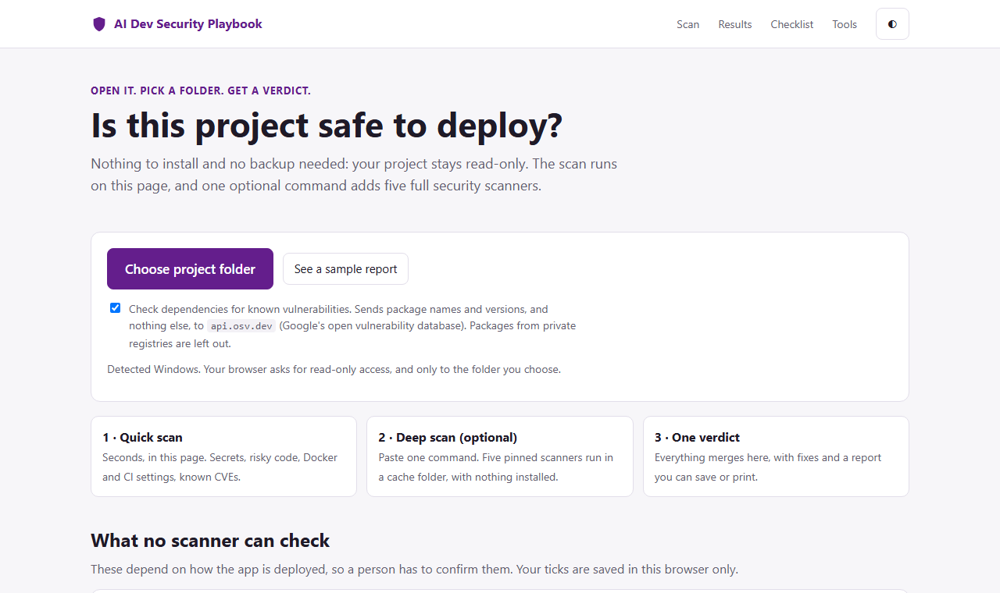
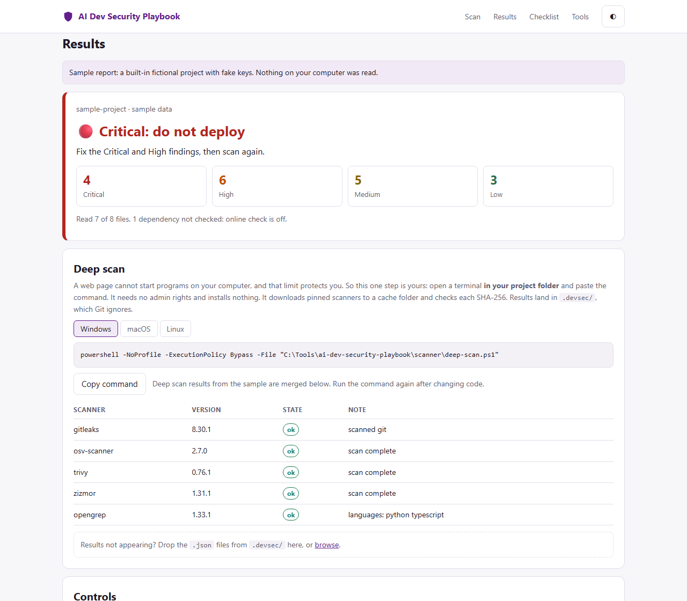
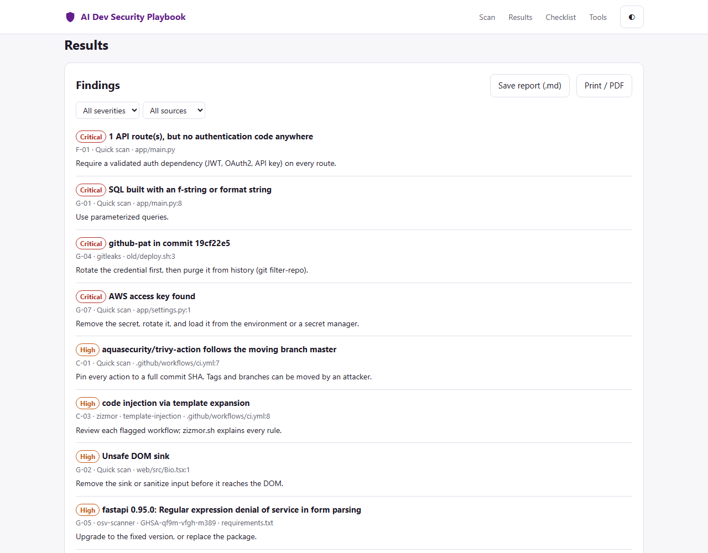

# AI Dev Security Playbook

**Is this project safe to deploy?** Open one HTML file, pick your project
folder, and get a verdict, with fixes, in seconds.

No install. No backup needed, because your project is opened read-only. No
server, no account, and no project code leaves your computer.



## Get started

1. [Download this repository](https://github.com/alouatiq/ai-dev-security-playbook/archive/refs/heads/main.zip)
   and unzip it anywhere.
2. Open **`index.html`** in Chrome or Edge.
3. Click **Choose project folder**.

Want a preview first? Click **See a sample report**.

## What you get



The verdict is one of four results:

| Verdict | Meaning |
| --- | --- |
| 🔴 **Critical** | Do not deploy. A Critical or High finding must be fixed. |
| ⚪ **Not cleared yet** | Nothing blocking so far, but the deep scan has not finished. |
| 🟡 **Accepted risk** | Nothing blocking. Accept the listed risks, and fix them before production. |
| 🟢 **Low risk** | All automated checks passed. Confirm the manual checklist before deploying. |

A quick scan alone can never give 🟢, because it cannot see Git history.

Each finding says where it is, which tool found it, and how to fix it:



## How it works

| | Quick scan | Deep scan (optional) |
| --- | --- | --- |
| **You do** | Choose a folder | Paste one command, shown for your OS |
| **Runs** | In the page | Five pinned scanners on your machine |
| **Finds** | Secrets, tracked key files, risky code, Docker and CI settings, known CVEs | Plus secrets in all of Git history, full code analysis (SAST), and IaC misconfiguration |
| **Writes** | Nothing | Only `.devsec/` in your project, which Git ignores |

**Why is there a command at all?** A web page cannot start programs on your
computer. That browser rule protects you, so no HTML file can run these
scanners by itself. The page detects your OS and gives you the exact command.
Run it in a terminal from your project folder, and results appear on the page
by themselves.

```powershell
# Windows
powershell -NoProfile -ExecutionPolicy Bypass -File "C:\path\to\ai-dev-security-playbook\scanner\deep-scan.ps1"
```

```bash
# macOS / Linux
bash "/path/to/ai-dev-security-playbook/scanner/deep-scan.sh"
```

The command needs no admin rights and installs nothing. Scanners download once
to a per-user cache: `%LOCALAPPDATA%\ai-dev-security-playbook` on Windows,
`~/.cache/ai-dev-security-playbook` elsewhere. Delete that folder to remove
every trace. Managed work computers may block downloaded programs. If so, the
scan reports which tool failed, and the verdict stays **Not cleared yet**.

## What it uses

| Tool | Job | Runs |
| --- | --- | --- |
| Built-in checks | Secret patterns, risky code, Docker and CI settings | In the page |
| [OSV.dev](https://osv.dev) | Known vulnerabilities in dependencies | In the page, online |
| [gitleaks](https://github.com/gitleaks/gitleaks) | Secrets in files and Git history | Deep scan |
| [osv-scanner](https://github.com/google/osv-scanner) | Dependency vulnerabilities | Deep scan |
| [Trivy](https://github.com/aquasecurity/trivy) | Vulnerabilities, Docker and IaC misconfiguration | Deep scan |
| [zizmor](https://github.com/zizmorcore/zizmor) | GitHub Actions weaknesses | Deep scan |
| [Opengrep](https://github.com/opengrep/opengrep) | Code analysis with Semgrep-compatible rules | Deep scan |

**Why Opengrep and not Semgrep?** Opengrep ships ready-to-run binaries for
Windows, macOS and Linux, while Semgrep's releases have none. Its rules are
downloaded when you scan and are never stored in this repository, because their
license does not allow that.

## Privacy and safety

- **Read-only.** The browser grants read access to the folder you choose.
- **What leaves your computer:** in the quick scan, public package names and
  versions go to `api.osv.dev`, and you can untick that. The deep scan's
  scanners also contact their own vulnerability databases.
- **Secret values are never kept.** Reports show the rule, file and line only.
- **Pinned scanners.** Every download must match a SHA-256 in
  [`scanner/tools.lock`](scanner/tools.lock), or it is refused. Moving tags are
  not trusted: Trivy's own release tags were hijacked in March 2026
  ([CVE-2026-33634](https://github.com/advisories/GHSA-69fq-xp46-6x23)).
- **The verdict has limits.** It covers automated checks only. It does not
  prove a project is secure, so the page includes a checklist for people.

## Browser support

| Browser | Quick scan | Deep-scan results |
| --- | --- | --- |
| Chrome, Edge | Yes | Appear by themselves |
| Firefox, Safari | Yes | Drop the `.devsec` files onto the page |

## Repository layout

```text
index.html       The whole app: open this
scanner/         Deep scan scripts and pinned tool hashes
docs/            The playbook and guides
audit/           Script-only audit for CI gates
pipelines/       GitHub and GitLab CI/CD templates to copy
templates/       CYB report and BIA/ACP templates
tests/           Scan engine tests: node --test tests/engine.test.mjs
security/        This repository's own audit trail
```

## Going further

- [The playbook](docs/PLAYBOOK.md): every control, verdict rules and CI/CD setup
- [Integration guide](docs/INTEGRATION_GUIDE.md): add the audit to another repo
- [Secret handling](docs/SECRET_HANDLING_GUIDE.md): rules for developers and AI agents
- [Release guide](docs/RELEASE_GUIDE.md) · [Tech stack](docs/TECH_STACK.md)

---

**Maintainer:** [Dr. AL OUATIQ H.](https://www.alouatiq.com)
